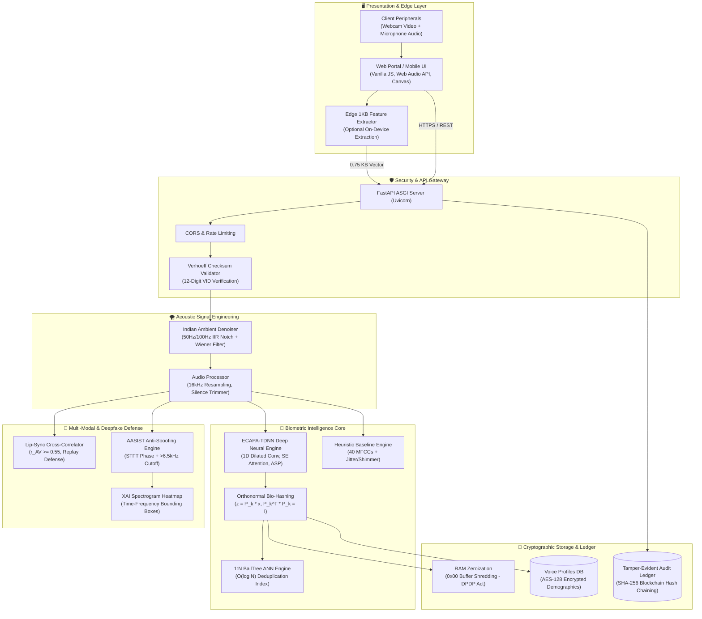
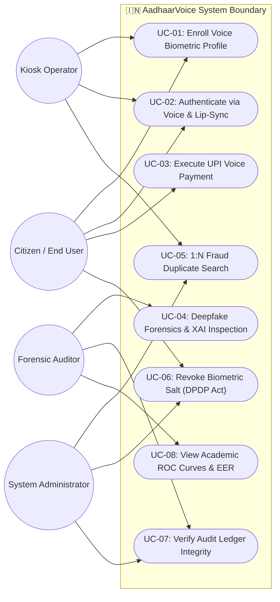
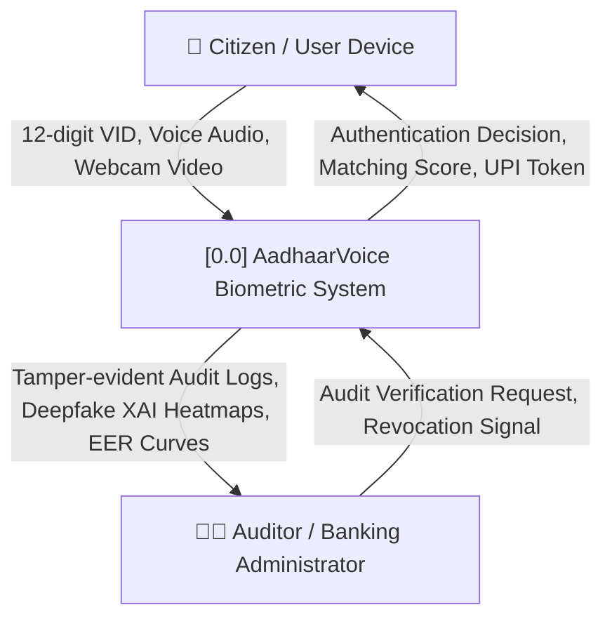
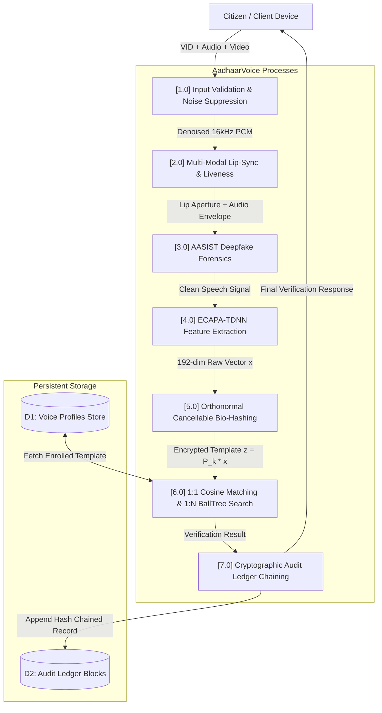
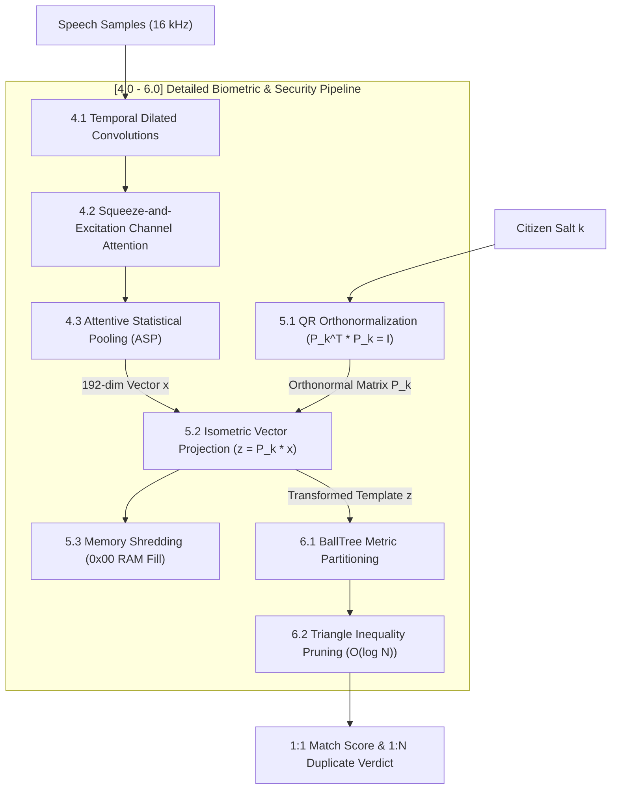
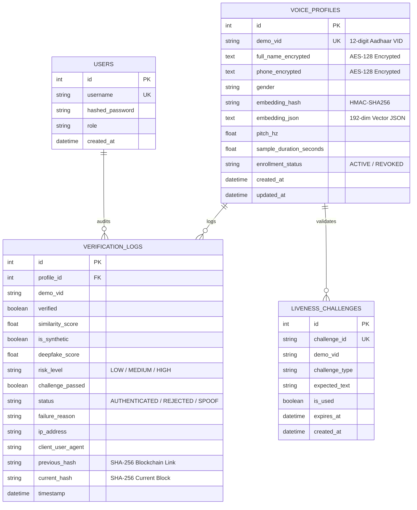
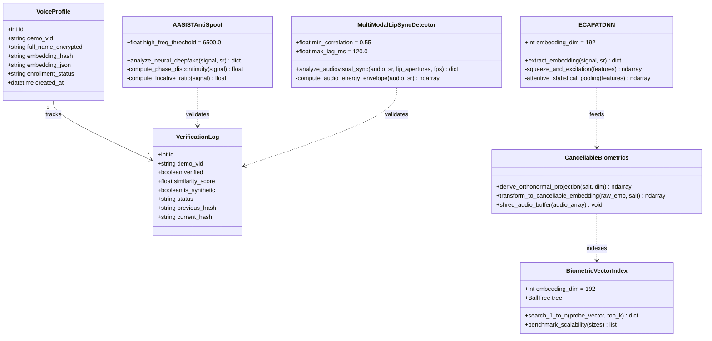
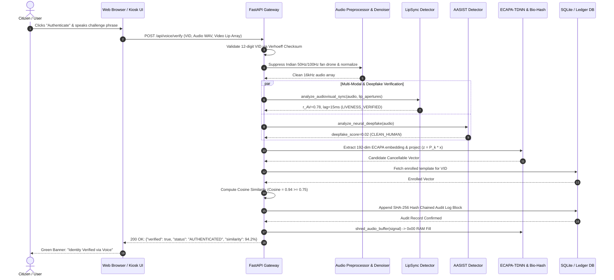
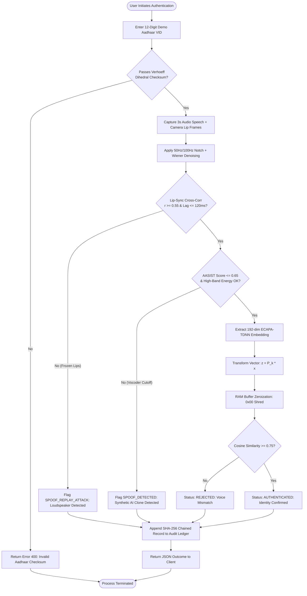

# 📐 System Architecture & UML Design Document
## AadhaarVoice: Comprehensive Diagrams & Database Specifications
**Major Project Phase 1 (Semester VII) | B.Tech Capstone Project**

---

## 📑 Diagram Index
1. **System Architecture Diagram** (Layered Deep-Tech Architecture)
2. **Use Case Diagram** (Actors & System Interactions)
3. **Data Flow Diagram (DFD) Level 0** (Context Level Diagram)
4. **Data Flow Diagram (DFD) Level 1** (Subsystem Decomposition)
5. **Data Flow Diagram (DFD) Level 2** (Detailed Verification Pipeline)
6. **Entity-Relationship (ER) Diagram** (Database Entities & Relationships)
7. **Class Diagram** (Core Classes, Attributes, and Methods)
8. **Sequence Diagram** (End-to-End Authentication Sequence)
9. **Activity Diagram** (Decision Workflow & Multi-Modal Liveness)
10. **Physical Database Schema** (Table Specifications & Constraints)

---

## 1. System Architecture Diagram

---

## 2. Use Case Diagram

---

## 3. Data Flow Diagram (DFD) Level 0 — Context Level

---

## 4. Data Flow Diagram (DFD) Level 1 — Subsystem Decomposition

---

## 5. Data Flow Diagram (DFD) Level 2 — Detailed Biometric Pipeline

---

## 6. Entity-Relationship (ER) Diagram

---

## 7. Class Diagram

---

## 8. Sequence Diagram (1:1 Verification Sequence)

---

## 9. Activity Diagram (Decision Flowchart)

---

## 10. Physical Database Schema

### Table 1: `users`
| Column Name | Data Type | Constraints | Description |
| :--- | :--- | :--- | :--- |
| `id` | `INTEGER` | `PRIMARY KEY AUTOINCREMENT` | Internal user ID |
| `username` | `VARCHAR(64)` | `UNIQUE, NOT NULL` | Operator / Auditor login username |
| `hashed_password` | `VARCHAR(255)` | `NOT NULL` | PBKDF2-HMAC-SHA256 salted password |
| `role` | `VARCHAR(32)` | `DEFAULT 'operator'` | RBAC role (`admin`, `operator`, `auditor`) |
| `created_at` | `DATETIME` | `DEFAULT UTC NOW` | Record creation timestamp |

### Table 2: `voice_profiles`
| Column Name | Data Type | Constraints | Description |
| :--- | :--- | :--- | :--- |
| `id` | `INTEGER` | `PRIMARY KEY AUTOINCREMENT` | Internal profile identifier |
| `demo_vid` | `VARCHAR(12)` | `UNIQUE, NOT NULL, INDEX` | 12-digit demo Aadhaar number passing Verhoeff |
| `full_name_encrypted` | `TEXT` | `NOT NULL` | AES-128 (Fernet) encrypted citizen legal name |
| `phone_encrypted` | `TEXT` | `NULLABLE` | AES-128 (Fernet) encrypted mobile number |
| `gender` | `VARCHAR(16)` | `DEFAULT 'unspecified'` | Demographic gender flag |
| `embedding_hash` | `VARCHAR(64)` | `NOT NULL` | HMAC-SHA256 cryptographic template digest |
| `embedding_json` | `TEXT` | `NOT NULL` | Serialized 192-float JSON vector |
| `pitch_hz` | `FLOAT` | `DEFAULT 150.0` | Fundamental frequency estimate ($F_0$) |
| `sample_duration_seconds` | `FLOAT` | `DEFAULT 0.0` | Duration of enrolled vocal sample |
| `enrollment_status` | `VARCHAR(32)` | `DEFAULT 'ACTIVE'` | Status (`ACTIVE`, `REVOKED`, `SUSPENDED`) |
| `created_at` | `DATETIME` | `DEFAULT UTC NOW` | Enrollment timestamp |
| `updated_at` | `DATETIME` | `DEFAULT UTC NOW` | Last update / salt reissuance timestamp |

### Table 3: `verification_logs`
| Column Name | Data Type | Constraints | Description |
| :--- | :--- | :--- | :--- |
| `id` | `INTEGER` | `PRIMARY KEY AUTOINCREMENT` | Internal log ID |
| `profile_id` | `INTEGER` | `FOREIGN KEY (voice_profiles.id)` | Enrolled profile reference |
| `demo_vid` | `VARCHAR(12)` | `INDEX, NOT NULL` | Aadhaar VID attempted |
| `verified` | `BOOLEAN` | `NOT NULL, DEFAULT FALSE` | Final authentication decision boolean |
| `similarity_score` | `FLOAT` | `NOT NULL` | Cosine similarity value $[-1.0, 1.0]$ |
| `is_synthetic` | `BOOLEAN` | `DEFAULT FALSE` | True if AASIST detected deepfake |
| `deepfake_score` | `FLOAT` | `NOT NULL` | Synthetic spoof probability $[0.0, 1.0]$ |
| `risk_level` | `VARCHAR(16)` | `DEFAULT 'LOW'` | Spoof risk classification (`LOW`, `HIGH`, `CRITICAL`) |
| `challenge_passed`| `BOOLEAN` | `DEFAULT TRUE` | Challenge-response verification boolean |
| `status` | `VARCHAR(32)` | `NOT NULL` | Verdict (`AUTHENTICATED`, `REJECTED`, `SPOOF_DETECTED`) |
| `failure_reason` | `VARCHAR(255)`| `NULLABLE` | Human-readable explanation of failure |
| `ip_address` | `VARCHAR(64)` | `DEFAULT '127.0.0.1'` | Client endpoint IP address |
| `client_user_agent`| `VARCHAR(255)`| `DEFAULT 'unknown'` | Client device / browser fingerprint |
| `previous_hash` | `VARCHAR(64)` | `NOT NULL` | SHA-256 hash of previous log block |
| `current_hash` | `VARCHAR(64)` | `NOT NULL` | SHA-256 hash of current log block |
| `timestamp` | `DATETIME` | `DEFAULT UTC NOW` | Exact UTC execution timestamp |

### Table 4: `liveness_challenges`
| Column Name | Data Type | Constraints | Description |
| :--- | :--- | :--- | :--- |
| `id` | `INTEGER` | `PRIMARY KEY AUTOINCREMENT` | Internal challenge ID |
| `challenge_id` | `VARCHAR(64)` | `UNIQUE, NOT NULL, INDEX` | Cryptographically generated UUID token |
| `demo_vid` | `VARCHAR(12)` | `NOT NULL` | Targeted citizen VID |
| `challenge_type` | `VARCHAR(32)` | `DEFAULT 'DIGIT_SEQUENCE'` | Dynamic challenge type (`DIGIT_SEQUENCE`, `PHRASE`) |
| `expected_text` | `VARCHAR(64)` | `NOT NULL` | Random digits/words to articulate |
| `is_used` | `BOOLEAN` | `DEFAULT FALSE` | Replay protection flag (one-time use) |
| `expires_at` | `DATETIME` | `NOT NULL` | Challenge expiration timestamp (TTL = 120s) |
| `created_at` | `DATETIME` | `DEFAULT UTC NOW` | Generation timestamp |
